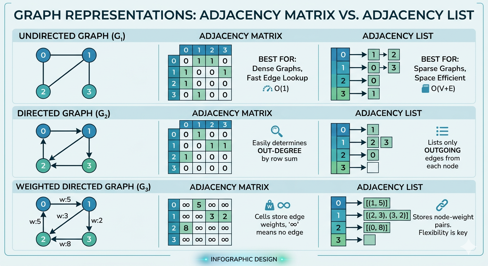

# View these notes as a website

This repository includes a Vite site that renders this document with a searchable table of contents.

```sh
npm ci
npm run dev
```

To publish on GitHub Pages, push to the `main` branch and set **Settings → Pages → Build and deployment → Source** to **GitHub Actions**. The workflow in `.github/workflows/deploy.yml` builds and deploys the site automatically.

# Asymptotic Notation
## [Master Theorem](https://www.programiz.com/dsa/master-theorem)
## [Amortized Time Complexity](https://stackoverflow.com/questions/15079327/amortized-complexity-in-laymans-terms)
### [Naukri.com](https://www.naukri.com/code360/library/amortized-time-complexity-in-data-structures)


# GCD and HCF Euclidean Concept

The Euclidean Algorithm is a method for finding the greatest common divisor (GCD) of two numbers. It operates on the principle that the GCD of two numbers remains the same even if the smaller number is subtracted from the larger number.

## Finding GCD using Euclidean Algorithm

To find the GCD of `n1` and `n2` where `n1 > n2`:
1. Repeatedly subtract the smaller number from the larger number until one of them becomes 0.
2. Once one of them becomes 0, the other number is the GCD of the original numbers.


[Source](https://takeuforward.org/strivers-a2z-dsa-course/strivers-a2z-dsa-course-sheet-2)

**Example:**

n1 = 20, n2 = 15 gcd(20, 15) = gcd(20-15, 15) = gcd(5, 15) gcd(5, 15) = gcd(15-5, 5) = gcd(10, 5) gcd(10, 5) = gcd(10-5, 5) = gcd(5, 5) gcd(5, 5) = gcd(5-5, 5) = gcd(0, 5) Hence, return 5 as the gcd.


# Divisor Related Theorems

We can optimize the previous approach by using the property that for any non-negative integer `n`, if `d` is a divisor of `n`, then `n/d` is also a divisor of `n`. This property is symmetric about the square root of `n`. By traversing just the first half, we can avoid redundant iteration and computations, improving the efficiency of the algorithm.

## Algorithm
1. Initialize an array to store the divisors.
2. Iterate from 1 to the square root of `n` using a loop variable `i`. For each value of `i`:
    - Check if `i` is a divisor of `n` by checking if `n` is divisible by `i` without a remainder (`n % i == 0`).
    - If `i` is a divisor, add it to the vector of divisors.
    - If `i` is different from `n/i`, add the counterpart divisor `n/i` to the vector of divisors.
3. After the loop, return the array of divisors.

# Checking Prime

## Algorithm / Intuition

We can optimize the algorithm by only iterating up to the square root of `n` when checking for factors. This is because if `n` has a factor greater than its square root, it must also have a factor smaller than its square root. This property is symmetric about the square root of `n`. By traversing just the first half, we can avoid redundant iteration and computations, improving the efficiency of the algorithm.


[Source](https://takeuforward.org/strivers-a2z-dsa-course/strivers-a2z-dsa-course-sheet-2)
## Algorithm

1. Initialize a counter variable `cnt` to count the number of factors to 0.
2. Begin a loop from 1 to the square root of `n`. This loop iterates through possible factors of `n`. For each value of `i` within the loop:
    - Check if `n` is divisible by `i` without any remainder.
    - If `n` is divisible by `i`, it means `i` is a factor of `n`, so increment the counter variable `cnt` by 1.
    - Check if the reciprocal factor of `i` i.e., `n/i` is not equal to `i`. If they are not equal, it means there is a distinct factor, so increment `cnt` by 1 again.
3. After the loop, `cnt` will contain the total number of factors of `n`.
4. Check if the value of `cnt` is exactly 2; it means that `n` has exactly two distinct factors (1 and itself), indicating that it is a prime number.
    - If the number of factors is greater than 2, then it is a composite number; return false.


# Recursion


# Sorting
## [Selection Sort Programiz](https://www.programiz.com/dsa/selection-sort)
**Selection sort is a sorting algorithm that selects the smallest element from an unsorted list in each iteration and places that element at the beginning of the unsorted list.**
1. Set the first element as `minimum`
2. a. Compare `minimum` with the second element. If the second element is smaller than `minimum`, assign the second element as `minimum`.

   b. Compare `minimum` with the third element. Again, if the third element is smaller, then assign `minimum` to the third element otherwise do nothing. The process goes on until the last element.
3. After each iteration, `minimum` is placed in the front of the unsorted list.
4. For each iteration, indexing starts from the first unsorted element. Step 1 to 3 are repeated until all the elements are placed at their correct positions.
```
def selectionSort(array, size):
    for step in range(size):
        min_idx = step
        for i in range(step + 1, size):
            # to sort in descending order, change > to < in this line
            # select the minimum element in each loop
            if array[i] < array[min_idx]:
                min_idx = i
        # put min at the correct position (swapping step)
        (array[step], array[min_idx]) = (array[min_idx], array[step])
```

## [Insertion Sort Programiz](https://www.programiz.com/dsa/insertion-sort)
- **Insertion sort is a sorting algorithm that places an unsorted element at its suitable place in each iteration.**
### Algorithm
1. a. The first element in the array is assumed to be sorted. Take the second element and store it separately in key.
   
   b. Compare key with the first element. If the first element is greater than key, then key is placed in front of the first element.
3. Now, the first two elements are sorted. Take the third element and compare it with the elements on the left of it. Placed it just behind the element smaller than it. If there is no element smaller than it, then place it at the beginning of the array.
4. Similarly, place every unsorted element at its correct position.
```
def insertionSort(array):
    for step in range(1, len(array)):
        key = array[step]
        j = step - 1
        # Compare key with each element on the left of it until an element smaller than it is found
        # For descending order, change key<array[j] to key>array[j].        
        while j >= 0 and key < array[j]:
            array[j + 1] = array[j]
            j = j - 1
        # Place key at after the element just smaller than it.
        array[j + 1] = key
```

## [Bubblesort Programiz](https://www.programiz.com/dsa/bubble-sort)
- **Just like the movement of air bubbles in the water that rise up to the surface, each element of the array move to the end in each iteration. Therefore, it is called a bubble sort.**
- **In Bubblesort, it compares two adjacent element and swaps them until they are in the intended order**
- After each iteration an element reaches at the intnded position- in case of ascending order largest element reaches the last position in first iteration and second largest element reaches the second last position in second iteration and so on but in descending order smallest element reaches the last position in first iteration and the second smallest element reaches the second last element and so on
### Code

```
def bubbleSort(array):
    
  # loop to access each array element
  for i in range(len(array)):

    # loop to compare array elements
    for j in range(0, len(array) - i - 1):

      # compare two adjacent elements
      # change > to < to sort in descending order
      if array[j] > array[j + 1]:

        # swapping elements if elements
        # are not in the intended order
        temp = array[j]
        array[j] = array[j+1]
        array[j+1] = temp
```


## [Quicksort Programiz](https://www.programiz.com/dsa/quick-sort)

In **Quicksort**, we select a pivot and divide the array at left and the array at right of the pivot **recursively**, we call this process **Partition, here we select a pivot and at the end of the function the pivot reaches its actual position in the array when it would be sorted**.
In **Partions**, we select a pivot and then we take two pinters one at the starting index (i, assumption) and another at the end of the array (j, assumption) and we perform following operations
 1. We increase i as long as the ith element is smaller than or equal to pivot
 2. We decrease j as long as jth element is greater than pivot
 3. if both of them have not met yet we swap ith and jth elements
 4. if they (i, j) have met or crossed each other we swap the jth element with pivot and return j

**Quicksort Function**
```
void Quicksort(vector<int> &arr, int low, int high) {
    if (low < high) {
        int pIndex = partition(arr, low, high);
        Quicksort(arr, low, pIndex - 1);
        Quicksort(arr, pIndex + 1, high);
    }
}
```

**Partition Function**
```
int partition(arr, low, high){
    pivot = arr[low];
    i = low;
    j = high;
    while(i<j){
        while(arr[i] <= pivot && i < high){
            i++;
        }
        while(arr[j] > pivot && j > low){
            j--;
        }
        if(i < j) swap(arr[i], arr[j]);
    }
    swap(arr[low], arr[j]);
    return j;
}
```

## [Mergesort Programiz](https://www.programiz.com/dsa/merge-sort)
**In Mergesort we divide the array into two halves recursively as long as there is no division possible and then we compare and merge two divided arrays**
```
class Solution {
  public:
    void merge(vector<int>& arr, int m, int l, int r){
        vector<int>temp;
        int right=m+1;
        int left=l;
        // Sorting two halves
        while(left<=m && right<=r){
            if(arr[left]<=arr[right]){
                temp.push_back(arr[left]);
                left++;
            }else{
                temp.push_back(arr[right]);
                right++;
            }
        }
        // Remaining elements in first half
        while(left<=m){
            temp.push_back(arr[left]);
            left++;
        }
        // Remaining elements in second half
        while(right<=r){
            temp.push_back(arr[right]);
            right++;
        }
        // All elements of temporary array being assigned to the original array
        for(int i=l; i<=r; i++){
            arr[i]=temp[i-l];
        }
    }
    void mergeSort(vector<int>& arr, int l, int r) {
        if(r<=l) return; // Base case
        int m=l+(r-l)/2; // Mid point
        // mergeSort(first half);
        mergeSort(arr, l, m);
        // mergeSort(second half)
        mergeSort(arr, m+1, r);
        //merge(first and second halves)
        merge(arr, m, l, r);
    }
};
```
## Recursive Bubblesort
## Recursive Insertion Sort

# Searching
## [Binary Search](https://www.programiz.com/dsa/binary-search)
There are two approaches of solving this problem, it works only on a **sorted** array.

**1. Iterative**
 
```
    do until the pointers low and high meet each other.
        mid = (low + high)/2
        if (x == arr[mid])
            return mid
        else if (x > arr[mid]) // x is on the right side
            low = mid + 1
        else                       // x is on the left side
            high = mid - 1
```
    
 **2. Recursive**
    
    It follows divide and conquer approach, we get the middle element and we compare it with the element 
    that we have to find, if it is same then we return the middle index, if it is smaller than the middle
    element we search in first half else if it is greater than the middle element we search in the second
    half, recursively.
    
```
    binarySearch(arr, x, low, high)
        if low > high
            return False 
        else
            mid = (low + high) / 2 
            if x == arr[mid]
                return mid
            else if x > arr[mid]        // x is on the right side
                return binarySearch(arr, x, mid + 1, high)
            else                               // x is on the left side
                return binarySearch(arr, x, low, mid - 1)
```
    
- Lower Bound
- Upper Bound

# Hashing
## Hash Table

# Linkedlist
```
using System;

public class Node{
    public int data;
    public Node next;
    
    public Node(int data){
        this.data = data;
        this.next = null;
    }
}

public class LinkedList{
    private Node head;
    
    public LinkedList(Node node){
        this.head = node;
    }
    public void InsertNode(Node node){
        Node temp = this.head;
        while(temp.next != null){
            temp = temp.next;
        }
        temp.next = node;
    }
    
    public int DeleteNode(Node node){
        Node temp = this.head;
        while(temp.next != null && temp.next.data != node.data){
            temp = temp.next;
        }
        if(temp.next.data == node.data){
            Node dn = temp.next;
            temp.next = temp.next.next;
            return dn.data;
        }
        return int.MinValue;
    }
    
    public void Display(){
        Node temp = this.head;
        while(temp != null){
            Console.Write(temp.data+"->");
            temp = temp.next;
        }
    }
}

public class Program{
    public static void Main(string[] args){
        Node nn = new Node(10);
        LinkedList ll = new LinkedList(nn);
        nn = new Node(5);
        ll.InsertNode(nn);
        nn = new Node(15);
        ll.InsertNode(nn);
        nn = new Node(25);
        ll.InsertNode(nn);
        nn = new Node(35);
        ll.InsertNode(nn);
        nn = new Node(45);
        ll.InsertNode(nn);
        nn = new Node(35);
        ll.DeleteNode(nn);
        nn = new Node(15);
        ll.DeleteNode(nn);
        ll.Display();
    }
}
```
# Stack (Array & Linkedlist)

```
using System;

public class Stack{
    private string[] stack;
    private int maxSize;
    private int top;
    
    public Stack(int maxSize){
        this.maxSize = maxSize;
        this.top = -1;
        this.stack = new string[maxSize];
    }
    
    private bool IsEmpty(){
        return this.top == -1;
    }
    private bool IsFull(){
        return this.top == maxSize-1;
    }
    
    public void Push(string data){
        if(IsFull()) return;
        this.stack[++top] = data;
    }
    public string Pop(){
        if(IsEmpty()) return "Empty Stack";
        return this.stack[top--];
    }
    public string Peek(){
        if(IsEmpty()) return "Empty Stack";
        return this.stack[top];
    }
    public int Top(){
        return this.top;
    }
}

public class Program{
    public static void Main()
    {
        Stack stack = new Stack(10);
        stack.Push("1");
        stack.Push("2");
        stack.Push("3");
        stack.Push("4");
        Console.WriteLine("Peeked item: " + stack.Peek());
        Console.WriteLine("Popped item: " + stack.Pop());
        Console.WriteLine("Popped item: " + stack.Pop());
        Console.WriteLine("Popped item: " + stack.Pop());
        Console.WriteLine("Stack after popping an element: ");
        int x = stack.Top();
        for (int i = 0; i <= x; i++)
        {
            Console.Write(stack.Pop() + " ");
        }
        stack.Push("10");
        stack.Push("20");
        stack.Push("30");
        stack.Push("40");
        Console.WriteLine("Stack after pushing some elements: ");
        x = stack.Top();
        for (int i = 0; i <= x; i++)
        {
            Console.Write(stack.Pop() + " ");
        }
    }
}
```

# Queue (Array & Linkedlist)
**Integer Queue**
```
using System;

public class Queue
{
    int MaxSize = 10;
    private int[] elements;
    private int front;
    private int rear;
    
    public Queue(){
        elements = new int[MaxSize];
        rear = front = -1;
    }
    
    public bool IsEmpty(){
        return front == -1;
    }
    
    private bool IsFull(){
        return rear == MaxSize-1;
    }
    
    public void Enqueue(int data){
        if(IsFull()) return;
        if(front == -1){
            front++;
            rear++;
        }
        else{
            rear++;
        }
        elements[rear] = data;
    }
    
    public int Dequeue(){
        if(IsEmpty()) return int.MinValue;
        int data = elements[front];
        if(front == rear) front = rear = -1;
        else front++;
        return data;
    }

    public static void Main(string[] args)
    {
        Console.WriteLine ("Queue Implementation");
        Queue queue = new Queue();
        queue.Enqueue(10);
        Console.WriteLine("Dequeued Element: "+ queue.Dequeue());
        queue.Enqueue(15);
        queue.Enqueue(17);
        queue.Enqueue(20);
        queue.Enqueue(25);
        queue.Enqueue(15);
        queue.Enqueue(17);
        queue.Enqueue(20);
        queue.Enqueue(25);
        Console.WriteLine("Dequeued Element: "+ queue.Dequeue());
        queue.Enqueue(15);
        queue.Enqueue(17);
        queue.Enqueue(20);
        queue.Enqueue(25);
        while(!queue.IsEmpty()){
            Console.Write(queue.Dequeue()+"->");
        }
    }
}
```

**Generic Queue**
```
using System;

public class CircularQueue<T>
{
    private T[] elements;
    private int front;
    private int rear;
    private int max;

    public CircularQueue(int size)
    {
        elements = new T[size];
        front = -1;
        rear = -1;
        max = size;
    }

    public void Enqueue(T item)
    {
        if ((rear + 1) % max == front)
        {
            Console.WriteLine("Queue is full");
            return;
        }

        if (front == -1)
        {
            front = 0;
        }

        rear = (rear + 1) % max;
        elements[rear] = item;
    }

    public T Dequeue()
    {
        if (front == -1)
        {
            Console.WriteLine("Queue is empty");
            return default(T);
        }

        T item = elements[front];
        if (front == rear)
        {
            front = -1;
            rear = -1;
        }
        else
        {
            front = (front + 1) % max;
        }
        return item;
    }

    public bool IsEmpty()
    {
        return front == -1;
    }

    public bool IsFull()
    {
        return (rear + 1) % max == front;
    }

    public int Size()
    {
        if (front == -1)
        {
            return 0;
        }
        else if (rear >= front)
        {
            return rear - front + 1;
        }
        else
        {
            return max - front + rear + 1;
        }
    }
}

class Program
{
    static void Main()
    {
        CircularQueue<int> queue = new CircularQueue<int>(5);

        queue.Enqueue(1);
        queue.Enqueue(2);
        queue.Enqueue(3);
        queue.Enqueue(4);
        queue.Enqueue(5);

        Console.WriteLine("Queue size: " + queue.Size());

        while (!queue.IsEmpty())
        {
            Console.WriteLine(queue.Dequeue());
        }

        Console.WriteLine("Queue size: " + queue.Size());
    }
}


```
## Priority Queue

# Tree
A nonlinear hierarchical data structure comprising `Nodes` connected by `Edges`.

**Node**: A node is an entity that contains data and pointers to its children nodes.


- The last nodes of each path are called **Leaf Nodes** or external nodes that do not contain a pointer to child nodes.
- The node having at least a child node is called an **Internal Node**.
- **The Height** of a node is the number of edges from the node to the deepest leaf (ie. the **longest path from the node to a leaf node**).
- **The Depth** of a node is the number of edges from the root to the node.
- The height of a Tree is the height of the root node or the depth of the deepest node.


  
## Binary Tree (Full, Perfect, Complete, Degenerate, Skewed, Balanced, AVL)
# Basic Implementation
```
// Online C# Editor for free
// Write, Edit and Run your C# code using C# Online Compiler

using System;

public class Node{
    public int data;
    public Node left, right;
    
    public Node(int data){
        this.data = data;
        left = right = null;
    }
}

public class BinaryTree{
    public Node root;
    
    public BinaryTree(){
        this.root = null;
    }
    
    // LevelOrderInsertion
    public Node LevelorderInsertion(int[] arr, Node root, int i){
        if(i<arr.Length){
            Node temp = new Node(arr[i]);
            root = temp;
            root.left = LevelorderInsertion(arr, root.left, 2*i+1);
            root.right = LevelorderInsertion(arr, root.right, 2*i+2);
        }
        return root;
    }
    
    // InorderTraversal
    public void InorderTraversal(Node root){
        if(root == null) return;
        InorderTraversal(root.left);
        Console.Write(root.data+ "->");
        InorderTraversal(root.right);
    }
    // PreorderTraversal
    public void PreorderTraversal(Node root){
        if(root == null) return;
        Console.Write(root.data+"->");
        PreorderTraversal(root.left);
        PreorderTraversal(root.right);
    }
    // PostorderTraversal
    public void PostorderTraversal(Node root){
        if(root == null) return;
        PostorderTraversal(root.left);
        PostorderTraversal(root.right);
        Console.Write(root.data+ "->");
    }
    
    public static void Main(string[] args){
        BinaryTree bt = new BinaryTree();
        int[] nodes = new int[50];
        for(int i=0; i<50; i++){
            nodes[i] = i;
        }
        Node root = bt.LevelorderInsertion(nodes, bt.root, 0);
        Console.WriteLine("Preorder Traversal");
        bt.PreorderTraversal(root);
        Console.WriteLine("");
        Console.WriteLine("Inorder Traversal");
        bt.InorderTraversal(root);
        Console.WriteLine("");
        Console.WriteLine("Postorder Traversal");
        bt.PostorderTraversal(root);
    }
}
```

## Tree Traversal (Pre, In, Post, BFS, Levelorder)

### Breadth First Search

```
using System;

public class CircularQueue
{
    private int[] elements;
    private int front;
    private int rear;
    private int max;

    public CircularQueue(int size)
    {
        elements = new int[size];
        front = -1;
        rear = -1;
        max = size;
    }

    public void Enqueue(int item)
    {
        if ((rear + 1) % max == front)
        {
            Console.WriteLine("Queue is full");
            return;
        }

        if (front == -1)
        {
            front = 0;
        }

        rear = (rear + 1) % max;
        elements[rear] = item;
    }

    public int Dequeue()
    {
        if (front == -1)
        {
            Console.WriteLine("Queue is empty");
            return -1; // Assuming -1 indicates an empty queue
        }

        int item = elements[front];
        if (front == rear)
        {
            front = -1;
            rear = -1;
        }
        else
        {
            front = (front + 1) % max;
        }
        return item;
    }

    public bool IsEmpty()
    {
        return front == -1;
    }

    public bool IsFull()
    {
        return (rear + 1) % max == front;
    }
}

public class Node
{
    public int data;
    public Node left, right;

    public Node(int item)
    {
        data = item;
        left = right = null;
    }
}

public class BinaryTree
{
    public Node root;

    public void BFS(Node root)
    {
        if (root == null)
        {
            return;
        }

        CircularQueue queue = new CircularQueue(100); // Assuming a max size of 100 for the queue
        queue.Enqueue(root.data);

        while (!queue.IsEmpty())
        {
            int nodeValue = queue.Dequeue();
            Console.Write(nodeValue + " ");

            // Find the node corresponding to nodeValue
            Node node = FindNode(root, nodeValue);
            
            if (node.left != null)
            {
                queue.Enqueue(node.left.data);
            }

            if (node.right != null)
            {
                queue.Enqueue(node.right.data);
            }
        }
    }

    private Node FindNode(Node root, int value)
    {
        if (root == null || root.data == value)
        {
            return root;
        }

        Node leftResult = FindNode(root.left, value);
        return leftResult != null ? leftResult : FindNode(root.right, value);
    }
}

class Program
{
    static void Main()
    {
        BinaryTree tree = new BinaryTree();
        tree.root = new Node(1);
        tree.root.left = new Node(2);
        tree.root.right = new Node(3);
        tree.root.left.left = new Node(4);
        tree.root.left.right = new Node(5);
        tree.root.right.left = new Node(6);
        tree.root.right.right = new Node(7);

        Console.WriteLine("Breadth-First Search (BFS) traversal of the binary tree:");
        tree.BFS(tree.root);
    }
}

```

### Levelorder Traversal

```
using System;

public class CircularQueue
{
    private Node[] elements;
    private int front;
    private int rear;
    private int max;

    public CircularQueue(int size)
    {
        elements = new Node[size];
        front = -1;
        rear = -1;
        max = size;
    }

    public void Enqueue(Node item)
    {
        if ((rear + 1) % max == front)
        {
            Console.WriteLine("Queue is full");
            return;
        }

        if (front == -1)
        {
            front = 0;
        }

        rear = (rear + 1) % max;
        elements[rear] = item;
    }

    public Node Dequeue()
    {
        if (front == -1)
        {
            Console.WriteLine("Queue is empty");
            return null; // Assuming null indicates an empty queue
        }

        Node item = elements[front];
        if (front == rear)
        {
            front = -1;
            rear = -1;
        }
        else
        {
            front = (front + 1) % max;
        }
        return item;
    }

    public bool IsEmpty()
    {
        return front == -1;
    }

    public bool IsFull()
    {
        return (rear + 1) % max == front;
    }
}

public class Node
{
    public int data;
    public Node left, right;

    public Node(int item)
    {
        data = item;
        left = right = null;
    }
}

public class BinaryTree
{
    public Node root;

    public void LevelOrderTraversal(Node root)
    {
        if (root == null)
        {
            return;
        }

        CircularQueue queue = new CircularQueue(100); // Assuming a max size of 100 for the queue
        queue.Enqueue(root);

        while (!queue.IsEmpty())
        {
            int levelNodeCount = CalculateLevelNodeCount(queue);
            
            while (levelNodeCount > 0)
            {
                Node node = queue.Dequeue();
                Console.Write(node.data + " ");

                if (node.left != null)
                {
                    queue.Enqueue(node.left);
                }

                if (node.right != null)
                {
                    queue.Enqueue(node.right);
                }

                levelNodeCount--;
            }

            Console.WriteLine();
        }
    }

    private int CalculateLevelNodeCount(CircularQueue queue)
    {
        int count = 0;
        int originalFront = queue.front;

        while (originalFront != queue.rear)
        {
            count++;
            originalFront = (originalFront + 1) % queue.max;
        }

        count++; // To include the rear element
        return count;
    }
}

class Program
{
    static void Main()
    {
        BinaryTree tree = new BinaryTree();
        tree.root = new Node(1);
        tree.root.left = new Node(2);
        tree.root.right = new Node(3);
        tree.root.left.left = new Node(4);
        tree.root.left.right = new Node(5);
        tree.root.right.left = new Node(6);
        tree.root.right.right = new Node(7);

        Console.WriteLine("Level Order Traversal of the binary tree:");
        tree.LevelOrderTraversal(tree.root);
    }
}


```


## Binary Search Tree


# String Algorithms
## Palindrome
### [Manacher's Algorithm for Longest Palindromic Substring](https://www.scaler.in/manachers-algorithm/#:~:text=Manacher's%20algorithm-,Manacher's%20algorithm%20is%20used%20to%20find%20the%20longest%20palindromic%20substring,substrings%20with%20odd%20lengths%20only.)

```

public class Solution {
    public string LongestPalindrome(string s) {
        int sL = 2 * s.Length + 3;
        char[] sChar = new char[sL];
        sChar[0] = '@';
        sChar[sL-1] = '$';
        int t = 1;
        foreach(var c in s){
            sChar[t++] = '#';
            sChar[t++] = c;
        }
        sChar[t] = '#';
        int[] p = new int[sL];
        int start, center, maxRight, maxLen;
        start = center = maxRight = maxLen = 0;
        for(int i=1; i<sL-1; i++){
            if(i<maxRight){
                p[i] = Math.Min(maxRight - i, p[2*center -i]);
            }
            while(sChar[i-p[i]-1] == sChar[i+p[i]+1]){
                p[i]++;
            }
            if(i+p[i] > maxRight){
                center = i;
                maxRight = i+p[i];
            }
            if(p[i] > maxLen){
                start = (i-p[i]-1)/2;
                maxLen = p[i];
            }
        }
        return s.Substring(start, maxLen);
    }
}

```


## Finding total number of digit 1 in a number
To find how many times the digit 1 appears in a given number, here’s a quick and clean way to do it in Python:

```
python
def count_ones(n):
    return str(n).count('1')
```

# Example usage
number = 1012114
print(f"Total number of digit 1 in {number}: {count_ones(number)}")
🔍 What's happening here:

The number is converted to a string using str(n)

Then count('1') tallies all occurrences of '1' in that string

If you’re trying to do this digit by digit without string conversion (say, in a coding interview), here’s a math-based approach:

```
python
def count_ones_math(n):
    count = 0
    while n > 0:
        if n % 10 == 1:
            count += 1
        n //= 10
    return count
```

# Example
number = 1012114
print(f"Total number of digit 1 in {number}: {count_ones_math(number)}")
Would you like to expand this logic to count all digits or perhaps digit 1 in a range like 1 to n? There’s a neat dynamic programming trick for that!

Is there any mathematical formula?
Yes—if you're looking to calculate the total number of times digit '1' appears from 1 to n, there’s indeed a mathematical approach that goes beyond brute-force iteration. It's not a simple one-line formula, but it’s built on positional analysis of each digit. Here's the idea:

📐 Mathematical Insight: Counting 1s from 1 to n
We analyze each digit position (units, tens, hundreds...) and determine how many times 1 appears in that position across all numbers from 1 to n.

🔣 Formula Logic (Positional Analysis)
Let’s say:

n = 2345

We want to count how many times digit 1 appears from 1 to 2345

We process digit by digit (from right to left):

For position i (starting from 0 for units digit), let:

```higher = n // (10^(i+1))``` – digits to the left

```current = (n // 10^i) % 10``` – digit at position i

```lower = n % (10^i)``` – digits to the right

The count of 1s at position i depends on:

If ```current > 1: (higher + 1) * 10^i```

If ```current == 1: (higher * 10^i) + (lower + 1)```

If ```current < 1: higher * 10^i```


Sure! Let’s break down the mathematical approach to counting how many times digit `1` appears from `1` to `n` using **positional analysis** — with a complete example to make everything crystal clear.

---

## 📊 Problem Statement
Count how many times digit `1` appears in **all numbers from 1 to 2345**.

We’ll analyze digit positions: units, tens, hundreds, thousands — and compute the contribution from each.

---

## 🧮 Step-by-Step Breakdown

Let’s denote:
- `n = 2345`
- We'll examine digit positions `0` (units) to `3` (thousands)

For each position `i`:
- `power = 10^i`
- `next_power = 10^(i+1)`
- `higher = n // next_power`
- `current = (n // power) % 10`
- `lower = n % power`

Then apply:
- If `current == 0`: `count += higher * power`
- If `current == 1`: `count += higher * power + (lower + 1)`
- If `current > 1`: `count += (higher + 1) * power`

---

### 🔍 Let's Apply It to `n = 2345`

### 🧩 Position 0 (Units)
- `power = 1`, `next_power = 10`
- `higher = 2345 // 10 = 234`
- `current = 2345 % 10 = 5`
- `lower = 0`

→ Since `current > 1`,  
`count += (234 + 1) * 1 = 235`

### 🧩 Position 1 (Tens)
- `power = 10`, `next_power = 100`
- `higher = 2345 // 100 = 23`
- `current = (2345 // 10) % 10 = 4`
- `lower = 2345 % 10 = 5`

→ `current > 1` →  
`count += (23 + 1) * 10 = 240`

### 🧩 Position 2 (Hundreds)
- `power = 100`, `next_power = 1000`
- `higher = 2345 // 1000 = 2`
- `current = (2345 // 100) % 10 = 3`
- `lower = 2345 % 100 = 45`

→ `current > 1` →  
`count += (2 + 1) * 100 = 300`

### 🧩 Position 3 (Thousands)
- `power = 1000`, `next_power = 10000`
- `higher = 2345 // 10000 = 0`
- `current = (2345 // 1000) % 10 = 2`
- `lower = 2345 % 1000 = 345`

→ `current > 1` →  
`count += (0 + 1) * 1000 = 1000`

---

### ✅ Total Count
Add all contributions:
- Units: `235`
- Tens: `240`
- Hundreds: `300`
- Thousands: `1000`

👉 **Total number of '1's from 1 to 2345 is `1775`**

---

### 🧠 Python Code Recap

```python
def count_ones_upto_n(n):
    count = 0
    i = 0
    while 10 ** i <= n:
        power = 10 ** i
        next_power = power * 10
        higher = n // next_power
        current = (n // power) % 10
        lower = n % power

        if current == 0:
            count += higher * power
        elif current == 1:
            count += higher * power + (lower + 1)
        else:
            count += (higher + 1) * power

        i += 1
    return count

print(count_ones_upto_n(2345))  # Output: 1775
```

---

If you want to modify this to count any other digit (e.g., `2`, `3`, etc.), there’s a generalized version. Want me to walk you through that next? 😊


[Number of 1s in 1 to n](https://stackoverflow.com/questions/35244719/count-the-total-number-of-1s-in-integers-from-1-to-n)

# Graph

# Graph Data Structure for Programmers

A **Graph** is a non-linear data structure representing a network of points connected by links. Unlike Trees, Graphs do not have a root-level starting point and can form complex, multi-directional relationships.

---

## 1. Core Components
*   **Vertices (Nodes):** The objects or data points (e.g., users, cities, web pages).
*   **Edges (Links):** The connections between nodes (e.g., friendships, roads, hyperlinks).

Mathematically, a graph is represented as **$G = (V, E)$**.

---

## 2. Graph Classifications


| Property | Type | Description |
| :--- | :--- | :--- |
| **Direction** | **Undirected** | Relationships are mutual ($A \leftrightarrow B$). |
| | **Directed** | Relationships have a direction ($A \to B$). |
| **Weight** | **Unweighted** | All edges are considered equal. |
| | **Weighted** | Edges have values like distance, cost, or time. |
| **Cycles** | **Cyclic** | You can return to a starting node via a path. |
| | **Acyclic** | No path exists that loops back to the same node. |

---

## 3. Programmatic Representations

### A. Adjacency List (Most Common)
An array or dictionary where each key is a node and its value is a list of connected neighbors.
*   **Space Complexity:** $O(V + E)$
*   **Best For:** Sparse graphs (where nodes have few connections).

```csharp
// Example in C#
Dictionary<int, List<int>> adjList = new()
{
    [0] = [1, 2], // Node 0 connects to 1 and 2
    [1] = [0, 3], // Node 1 connects to 0 and 3
    [2] = [0],    // Node 2 connects to 0
    [3] = [1]     // Node 3 connects to 1
};
```
### B. Adjacency Matrix

A 2D array where matrix[i][j] represents the presence (and weight) of an edge between node i and node j.
* **Space Complexity**: $O(V^2)$
* **Best For**: Dense graphs or fast edge-existence lookups.
```
// Example in C# (1 = Edge exists, 0 = No edge)
int[,] matrix = {
    { 0, 1, 1, 0 },
    { 1, 0, 0, 1 },
    { 1, 0, 0, 0 },
    { 0, 1, 0, 0 }
};
```
## 4. Key Algorithms
* **BFS (Breadth-First Search)**: Explores neighbours first. Uses a Queue. (Shortest path in unweighted graphs).
* **DFS (Depth-First Search)**: Explores as far as possible along a branch before backtracking. Uses Recursion or a Stack.
* **Dijkstra’s Algorithm**: Finds the shortest path in a weighted graph.



### BFS Algorithm
#### Undirected, Disconnected Graphs

For an **undirected graph** that may be **disconnected** (composed of multiple "islands"), the Breadth-First Search (BFS) must be wrapped in a loop that checks every vertex. This ensures that every component of the graph is traversed.

---

### 1. The Algorithm Logic

1.  **Initialize** a `visited` boolean array of size $V$, with all values set to `false`.
2.  **Iterate** through every vertex $i$ from $0$ to $V-1$:
    *   **If** vertex $i$ is not `visited`:
        *   Launch a **BFS** starting from vertex $i$.
3.  **The BFS Procedure**:
    *   Create an empty **Queue** and enqueue the starting node.
    *   Mark the starting node as `visited`.
    *   **While** the Queue is not empty:
        *   **Dequeue** the current node.
        *   **Process** the node (e.g., print it).
        *   For each **neighbor** of the current node:
            *   **If** the neighbor has not been `visited`:
                *   Mark it as `visited`.
                *   **Enqueue** the neighbor.

---
*   **Space Complexity:** $O(V + E)$
*   **Time Complexity:** $O(V)$

### 2. Implementation (C#)

Based on the **Adjacency List** representation (best for space efficiency as shown in the image), here is the implementation:

```csharp
using System;
using System.Collections.Generic;

public class GraphBfs
{
    public List<int> Traversal(List<int>[] adj)
    {
        int V = adj.Length;
        bool[] visited = new bool[V];
        List<int> res = [];
        // Loop handles disconnected components (G1, G2, etc.)
        for (int i = 0; i < V; i++)
        {
            if (!visited[i])
            {
                PerformBfs(adj, i, visited);
            }
        }
        return res;
    }
    // For connected graph
    private void PerformBfs(List<int>[] adj, int node, bool[] visited, List<int> res)
    {
        Queue<int> queue = new();

        visited[node] = true;
        queue.Enqueue(node);

        while (queue.Count > 0)
        {
            int curr = queue.Dequeue();
            res.Add(curr);
            foreach (int neighbor in adj[curr])
            {
                if (!visited[neighbor])
                {
                    visited[neighbor] = true;
                    queue.Enqueue(neighbor);
                }
            }
        }
    }
}
```

### DFS Algorithm

#### Undirected Graphs

Depth-First Search is an algorithm for traversing or searching tree or graph data structures. The algorithm starts at a root node (selecting some arbitrary node as the root in the case of a graph) and explores as far as possible along each branch before backtracking.

---

### 1. The Algorithm Logic

For an **undirected, unweighted graph** that may be **disconnected**, the algorithm follows these steps:

1.  **Initialize** a `visited` boolean array of size $V$ (number of vertices) to `false`.
2.  **Iterate** through every vertex $i$ from $0$ to $V-1$:
    *   **If** vertex $i$ is not `visited`:
        *   Start a recursive **DFS** call for vertex $i$.
3.  **The Recursive Procedure**:
    *   Mark the current node as `visited`.
    *   **Process** the node (e.g., print its value).
    *   For each **neighbor** of the current node:
        *   **If** the neighbor has not been `visited`:
            *   Recursively call the DFS function for that neighbor.

---
*   **Space Complexity:** $O(V + E)$
*   **Time Complexity:** $O(V)$
### 2. Implementation (C#)

Following the **Adjacency List** representation ($G_1$ in the infographic), which is best for space efficiency ($O(V+E)$):

```csharp
using System;
using System.Collections.Generic;

public class GraphDfs
{
    public List<int> Traversal(List<int>[] adj)
    {
        int V = adj.Length;
        bool[] visited = new bool[V];
        List<int> res = [];

        // Loop ensures all disconnected components are visited
        for (int i = 0; i < V; i++)
        {
            if (!visited[i])
            {
                PerformDfs(adj, i, visited, res);
            }
        }
        return res;
    }

    private void PerformDfs(List<int>[] adj, int curr, bool[] visited, List<int> res)
    {
        // Mark node as visited and process it
        visited[curr] = true;
        res.Add(curr);

        // Recursively visit all unvisited neighbors
        foreach (int neighbor in adj[curr])
        {
            if (!visited[neighbor])
            {
                PerformDfs(adj, neighbor, visited, res);
            }
        }
    }
}
```

## Cycle Detection Undirected Graph

Detecting a cycle in an **undirected graph** (like $G_1$ in the infographic) requires tracking the **parent** of each node during traversal. Because an undirected edge between $U$ and $V$ is bidirectional ($U \leftrightarrow V$), we must distinguish between a genuine cycle and simply moving back to the node we just came from.

---

### 1. The Algorithm Logic (DFS Approach)

The most efficient way to detect a cycle is using **Depth-First Search (DFS)**. 

1.  **Initialize** a `visited` boolean array of size $V$ to `false`.
2.  **Iterate** through every vertex $i$ from $0$ to $V-1$:
    *   **If** vertex $i$ is not `visited`:
        *   Start a recursive **DFS** call passing the current node and a `parent` (initially -1).
3.  **The Recursive Procedure**:
    *   Mark the current node as `visited`.
    *   For each **neighbor** of the current node:
        *   **Case A:** If the neighbor is **not visited**:
            *   Recursively call the function for this neighbor. If it returns `true`, a cycle exists.
        *   **Case B:** If the neighbor is **already visited** AND it is **not the parent**:
            *   **Cycle Detected!** This means we found another path to an already visited node that isn't the immediate return path.

---

*   **Space Complexity:** $O(V + E)$
*   **Time Complexity:** $O(V)$

### 2. Implementation (C#)

Following the **Adjacency List** representation shown in the image for $G_1$:

```csharp
using System;
using System.Collections.Generic;

public class GraphCycleDetection
{
    public bool HasCycle(List<int>[] adj)
    {
        int V = adj.Length;
        bool[] visited = new bool[V];

        // Loop to handle disconnected components
        for (int i = 0; i < V; i++)
        {
            if (!visited[i])
            {
                // Start DFS with parent as -1
                if (IsCyclicRecursive(adj, i, -1, visited))
                    return true;
            }
        }
        return false;
    }

    private bool IsCyclicRecursive(List<int>[] adj, int curr, int parent, bool[] visited)
    {
        visited[curr] = true;

        foreach (int neighbor in adj[curr])
        {
            // If neighbor is not visited, recurse
            if (!visited[neighbor])
            {
                if (IsCyclicRecursive(adj, neighbor, curr, visited))
                    return true;
            }
            // If visited neighbor is not the parent, we found a cycle
            else if (neighbor != parent)
            {
                return true;
            }
        }
        return false;
    }
}
```

### Cycle Detection in Undirected Graphs (BFS Approach)

While DFS is the most common method, **Breadth-First Search (BFS)** can also detect cycles in undirected graphs ($G_1$ in the infographic). The logic relies on tracking the **parent** of each node to distinguish between a "return path" and a "genuine cycle."

---

### 1. The Algorithm Logic

1.  **Initialize** a `visited` boolean array and a `parent` array (both size $V$). Set all `parent` values to `-1`.
2.  **Iterate** through every vertex $i$ from $0$ to $V-1$ (to handle disconnected components).
    *   **If** vertex $i$ is not `visited`:
        *   Start a **BFS** from vertex $i$.
3.  **The BFS Procedure**:
    *   Create a **Queue** and enqueue the starting node.
    *   Mark the starting node as `visited`.
    *   **While** the Queue is not empty:
        *   **Dequeue** the current node `curr`.
        *   For each **neighbor** of `curr`:
            *   **Case A:** If the neighbor is **not visited**:
                *   Mark it as `visited`.
                *   Set `parent[neighbor] = curr`.
                *   **Enqueue** the neighbor.
            *   **Case B:** If the neighbor is **already visited** AND it is **not the parent** of `curr`:
                *   **Cycle Detected!** We reached a visited node through a different path.

---
*   **Space Complexity:** $O(V + E)$
    * In the worst case, every vertex $(V)$ and every edge $(E)$ is explored. 
*   **Time Complexity:** $O(V)$
    * Required for the visited array and the queue

### 2. Implementation (C#)

Following the **Adjacency List** model ($O(V+E)$ space) for the undirected graph $G_1$:

```csharp
using System;
using System.Collections.Generic;

public class GraphCycleDetection
{
    public bool HasCycle(List<int>[] adj)
    {
        int V = adj.Length;
        bool[] visited = new bool[V];

        for (int i = 0; i < V; i++)
        {
            if (!visited[i])
            {
                if (CheckCycleBfs(adj, i, visited))
                    return true;
            }
        }
        return false;
    }

    private bool CheckCycleBfs(List<int>[] adj, int src, bool[] visited)
    {
        // Store (current_node, parent_node) in the queue
        Queue<(int curr, int parent)> queue = new();

        visited[src] = true;
        queue.Enqueue((src, -1));

        while (queue.Count > 0)
        {
            var (curr, parent) = queue.Dequeue();

            foreach (int neighbor in adj[curr])
            {
                if (!visited[neighbor])
                {
                    visited[neighbor] = true;
                    queue.Enqueue((neighbor, curr));
                }
                // If neighbor is visited and not the parent, a cycle exists
                else if (neighbor != parent)
                {
                    return true;
                }
            }
        }
        return false;
    }
}

```

## Topological Sort for Directed Acyclic Graphs (DAG)

Topological Sort is a linear ordering of vertices such that for every directed edge $u \to v$, vertex **$u$** comes before **$v$** in the ordering. This is essential for scheduling tasks, resolving dependencies, and compiling code.

---

### 1. Crucial Requirements
*   **Directed Graph ($G_2$ or $G_3$):** Relationships must have a direction.
*   **Acyclic:** The graph **must not** contain cycles. If a cycle exists ($A \to B \to A$), no linear ordering is possible.

---

### 2. Algorithm 1: Kahn's Algorithm (BFS Approach)
Kahn's algorithm uses the **In-Degree** of nodes (the number of incoming edges).

#### The Logic:
1.  **Calculate In-Degree:** For every node, count how many edges point to it.
2.  **Initialize Queue:** Enqueue all nodes with an **In-Degree of 0** (nodes with no dependencies).
3.  **Process Queue:**
    *   Dequeue a node `u` and add it to the topological order.
    *   For each neighbor `v` of `u`:
        *   Decrement the In-Degree of `v`.
        *   If `v`'s In-Degree becomes **0**, enqueue it.
4.  **Check for Cycles:** If the final order contains fewer nodes than the total vertices, the graph has a cycle.

* **Time Complexity**: $O(V+E)$
    * Similar to standard DFS, we visit every vertex $(V)$ and every outgoing edge $(E)$ exactly once.
* **Space Complexity**: $O(V)$ 
    * Used for the visited array, the Stack, and the Recursion Stack in memory.


#### C# Implementation:
```csharp
public List<int> KahnTopologicalSort(int V, List<int>[] adj) {
    int[] inDegree = new int[V];
    foreach (var list in adj) {
        foreach (int neighbor in list) inDegree[neighbor]++;
    }

    Queue<int> queue = new();
    for (int i = 0; i < V; i++) {
        if (inDegree[i] == 0) queue.Enqueue(i);
    }

    List<int> topoOrder = [];
    while (queue.Count > 0) {
        int u = queue.Dequeue();
        topoOrder.Add(u);

        foreach (int v in adj[u]) {
            if (--inDegree[v] == 0) queue.Enqueue(v);
        }
    }

    return topoOrder.Count == V ? topoOrder : throw new Exception("Graph has a cycle!");
}
```

# Topological Sort: DFS-Based Approach

The **Depth-First Search (DFS)** approach to Topological Sorting uses a **Stack** to store nodes after their neighbors have been fully explored. This is particularly effective for graphs like **$G_2$** and **$G_3$** in the infographic.

---

### 1. The Algorithm Logic

1.  **Initialize** a `visited` boolean array of size $V$ to `false`.
2.  **Initialize** an empty **Stack** to store the result.
3.  **Iterate** through every vertex $i$ from $0$ to $V-1$:
    *   **If** vertex $i$ is not `visited`:
        *   Start the recursive **DFS procedure**.
4.  **The Recursive Procedure**:
    *   Mark the current node as `visited`.
    *   For each **neighbor** of the current node:
        *   **If** the neighbor is not `visited`, recursively call the DFS for that neighbor.
    *   **Crucial Step:** Once all neighbors of the current node are fully explored, **Push** the current node onto the Stack.
5.  **Final Step:** Pop all elements from the Stack to get the topological order.

---

### 2. Implementation (C#)

Following the **Adjacency List** model for directed graphs ($G_2$):

```csharp
using System;
using System.Collections.Generic;

public class GraphTopologicalSort
{
    public void TopoSort(List<int>[] adj)
    {
        int V = adj.Length;
        bool[] visited = new bool[V];
        Stack<int> stack = new();

        // Visit every node to handle disconnected components
        for (int i = 0; i < V; i++)
        {
            if (!visited[i])
            {
                DfsRecursive(adj, i, visited, stack);
            }
        }

        // Output the results by popping from the stack
        Console.WriteLine("Topological Sort Order:");
        while (stack.Count > 0)
        {
            Console.Write(stack.Pop() + " ");
        }
    }

    private void DfsRecursive(List<int>[] adj, int curr, bool[] visited, Stack<int> stack)
    {
        visited[curr] = true;

        foreach (int neighbor in adj[curr])
        {
            if (!visited[neighbor])
            {
                DfsRecursive(adj, neighbor, visited, stack);
            }
        }

        // All neighbors are explored, now push current node to stack
        stack.Push(curr);
    }
}
```
# Cycle Detection in Directed Graphs

Detecting a cycle in a **Directed Graph** (like $G_2$ or $G_3$ in the infographic) is more complex than in an undirected graph. Because edges have a specific direction, simply reaching a visited node does not guarantee a cycle; instead, we must find a **back-edge** to a node currently in the **Recursion Stack**.

---

### 1. The Algorithm Logic (DFS Approach)

The standard approach uses **Depth-First Search (DFS)** and maintains two tracking mechanisms:
1.  **Visited Array:** Tracks all nodes that have been fully processed.
2.  **Recursion Stack Array:** Tracks nodes that are currently "active" in the current DFS path.

#### The Procedure:
1.  **Initialize** two boolean arrays: `visited` and `recStack` (both size $V$).
2.  **Iterate** through every vertex $i$ from $0$ to $V-1$:
    *   If vertex $i$ is not `visited`, start the recursive **DFS**.
3.  **In the DFS Recursive Function**:
    *   Mark the current node as `visited` AND add it to `recStack`.
    *   For each **neighbor** of the current node:
        *   **Case A:** If the neighbor is not `visited`, recurse. If it returns `true`, a cycle exists.
        *   **Case B:** If the neighbor is already in `recStack`, **Cycle Detected!** (A back-edge was found).
    *   **Crucial Step:** Once the function finishes exploring neighbors, remove the current node from `recStack` (backtrack).

---
* **Time Complexity**: $O(V+E)$
    * Each vertex and edge is visited once.
* **Space Complexity**: $O(V)$ 
    * Required for the visited array, recStack array, and the function call stack.

### 2. Implementation (C#)

Following the **Adjacency List** model ($O(V+E)$ space) for the directed graph $G_2$:

```csharp
using System;
using System.Collections.Generic;

public class DirectedCycleDetection
{
    public bool HasCycle(List<int>[] adj)
    {
        int V = adj.Length;
        bool[] visited = new bool[V];
        bool[] recStack = new bool[V];

        for (int i = 0; i < V; i++)
        {
            if (!visited[i])
            {
                if (IsCyclicRecursive(adj, i, visited, recStack))
                    return true;
            }
        }
        return false;
    }

    private bool IsCyclicRecursive(List<int>[] adj, int curr, bool[] visited, bool[] recStack)
    {
        // 1. Mark node as visited and add to recursion stack
        visited[curr] = true;
        recStack[curr] = true;

        foreach (int neighbor in adj[curr])
        {
            // If neighbor not visited, recurse
            if (!visited[neighbor])
            {
                if (IsCyclicRecursive(adj, neighbor, visited, recStack))
                    return true;
            }
            // If neighbor is currently in recursion stack, a cycle is found
            else if (recStack[neighbor])
            {
                return true;
            }
        }

        // 2. Remove node from recursion stack (backtrack)
        recStack[curr] = false;
        return false;
    }
}
```
### 4. Why "Parent Tracking" Fails Here
In an undirected graph, reaching any visited node (that isn't the parent) is a cycle. In a directed graph, reaching a visited node that is not in the current recursion stack is simply a cross-edge or forward-edge, which does not form a cycle.
Example: ```0->1``` and ```0->2```.

Node 1 is visited twice, but there is no cycle.

## 5. Alternative: Kahn's Algorithm (BFS)
You can also detect cycles using Kahn's Algorithm (Topological Sort). If the final topological sort contains fewer than $(V)$ nodes, the graph has at least one cycle.
